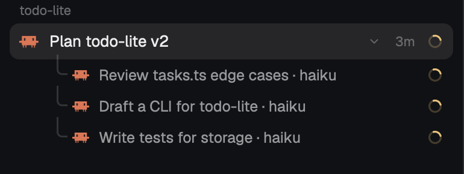

# herdr-agents-subagents

A [Herdr](https://herdr.dev) mod: the Agents list of the sidebar, plus the
Claude Code sub-agents each Claude session is running, nested under it with
their description and model.



## Install

It has two parts: the mod, and an optional Claude Code `SessionStart` hook
that tells Herdr where each session keeps its sub-agents. Without the hook,
the mod finds each session from Claude Code's process record; the hook
covers the cases where that can't work (see RECIPE.md, Watch out).

1. Ask your agent in Herdr:

   > Read ~/.config/herdr-app/AGENTS.md, then add this mod: herdr.dev/mods/ausema/herdr-agents-subagents

   Then put `agents-subagents` in your layout's Agents panel in place of
   `agents`.

2. Optionally, install the hook (needs `jq`):

   ```sh
   mkdir -p ~/.claude/hooks
   cp claude-code/hooks/herdr-label-claude-session ~/.claude/hooks/
   chmod +x ~/.claude/hooks/herdr-label-claude-session
   ```

   and add it to `~/.claude/settings.json`:

   ```json
   {
     "hooks": {
       "SessionStart": [
         { "hooks": [{ "type": "command", "command": "~/.claude/hooks/herdr-label-claude-session", "timeout": 5 }] }
       ]
     }
   }
   ```

   Sessions started after that are labelled by the hook.

What it touches: the hook runs `herdr-core label` on the session's own
terminal. The mod runs `find` every 3 s and reads the `agent-*.meta.json`
files in the session folders under `~/.claude/projects/`; for Claude
terminals without the label it also reads `~/.claude/sessions/<pid>.json`. No network calls.

## Develop

```sh
(cd mods/agents-subagents && node --test test/*.test.js)
bash claude-code/hooks/tests/herdr-label-claude-session.test.sh
```

See [RECIPE.md](RECIPE.md) for how it looks and behaves.
