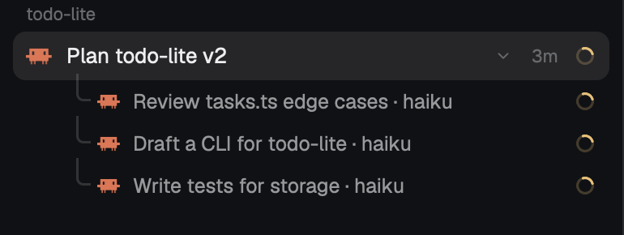

# Agents + sub-agents

The sidebar's Agents list, with the Claude Code sub-agents each Claude
session has running shown under it as a tree: one row per sub-agent with
its description, its model and a spinner while it works. They disappear
when they finish.

## What you see

Everything of Herdr's shipped `agents` mod (0.1.18) stays as it is: the
`Agents` header with the sort button (`Priority` / `Grouped by space`),
the groups, the agent rows with icon, name, time since the last change,
pin on hover and status, and the collapsed rail with numbers.

Added under each Claude Code agent row:

- **Sub-agent rows**: 26 px tall, rounded 8 px, 39 px left padding, 12.5 px
  text, one per running sub-agent of that session.
  - Tree lines in front: a 9 × 17 px box with a 1.5 px `input` left border;
    the branch to the row adds a 1.5 px bottom border rounded 6 px
    bottom-left (`├` / `└`).
  - The parent's program icon at 14 px (the Claude icon).
  - The name in `muted`, truncated: `<description> · <model>`, e.g.
    `Review tasks.ts edge cases · haiku`, with a full model id cut to its
    family (`claude-opus-5-5` → `opus`); just the description without a
    model; the agent type (`Explore`, `general-purpose`) without a
    description.
  - At the right, the `working` spinner: 12 px, one turn every 900 ms.
- **Fold chevron** on the parent row (11 px, `dim`): folded, it shows the
  number of sub-agents, colored by the most urgent one.

## How it behaves

- **Which sessions**: a live terminal with a `claude_subagents` label uses
  that folder. A live local terminal running `claude` without the label
  (started before the hook was installed, or no hook) is looked up instead:
  `~/.claude/sessions/<foreground pid>.json` gives its `sessionId`, and
  `find ~/.claude/projects -mindepth 2 -maxdepth 2 -name <sessionId>.jsonl`
  its transcript; the folder is `<transcript without .jsonl>/subagents`.
  The record is read every poll, so `/clear` and `/resume` are followed;
  the transcript is searched for once per session. The label is never
  written back.
- **Which sub-agents**: every 3 s, for each of those folders, the panel lists `agent-*.jsonl` in that folder
  modified in the last 30 minutes and reads the `agent-<id>.meta.json` next
  to each. A sub-agent shows while its meta has no `finished: true`; a
  missing or half-written meta hides it until the next poll.
- **Status**: always `working` while shown. It is never `done`: it reports
  to its parent, and the parent's done is the news. In `Priority` sort a
  parent with working sub-agents ranks at least as `Working`.
- **Clicks**: a sub-agent row does nothing (it has no terminal of its own);
  clicking the parent's icon or the chevron folds or unfolds its tree;
  clicking the parent row focuses its pane as before.
- **Updates**: the list only re-renders when the set of sub-agents changes;
  a poll that fails keeps the last list.
- **The hook**: at every Claude Code session start inside a Herdr terminal
  (`HC_TERMINAL_ID` set), it labels that terminal
  `claude_subagents=<transcript path without .jsonl>/subagents`. A Claude
  started from inside another Claude in the same terminal does not relabel
  it: walking up from the hook, the terminal's foreground process must come
  before any other `claude`. It never blocks or fails the session start.

## Built from

- `mods/agents-subagents/`: `main.js` (Herdr's `agents` 0.1.18 view plus
  the sub-agent poll), `claude-subagents.js` (label name, transcript name
  parser, meta parser, meta → virtual terminal rows), tests. `mod.json`:
  `"place": "none"`, `"title": "Agents"`, `cloned_from` `agents` 0.1.18.
- Changes to the shipped `main.js`: import `exec`, `home`,
  `readTextFile` and `readFile` from `fs/promises`; `lookUpSubagentsDir()`,
  `loadSubagents()`; `refreshSubagents()` started in `init`
  and every 3 s with `cx.timer.every`; `const all = [...terminals(),
  ...this.subagents]`; sub-agent rows with `virtual: true` ignore clicks;
  the sort popup opens `mod: "agents-subagents"`.
- A sub-agent is a virtual terminal `{address: "claude-sub:<id>", parent:
  <claude terminal address>, state: "live", status: "working", name,
  program: <parent's program>, virtual: true}`, so the shipped tree code
  draws it like any sub-agent.
- `herdr`: `agents`, `terminals`, `panes`, `focused`, `spaces`, `run`,
  `theme`, `shared`/`setShared`, `setAgentOrder`, `openOverlay`/
  `closeOverlay`, `props`, `window`, `layout`, `exec`, `home`,
  `readTextFile`. Icons from the
  shipped `mods/workspace-chrome/`.
- Programs: `find` (mod); `herdr-core get`/`label`, `jq`, `ps` (hook).
- `claude-code/hooks/herdr-label-claude-session`: the Claude Code
  `SessionStart` hook, with a test that runs it against a fake
  `herdr-core`.

## Watch out

- The hook is optional: without it, sessions are found through their
  process record. That needs the terminal's foreground process to be
  `claude` itself (not a wrapper script or `npx`) and Claude Code's files
  under `~/.claude` (not `CLAUDE_CONFIG_DIR`); otherwise only the hook
  works. Terminals on other machines need the hook too.
- It reads Claude Code's own files (`~/.claude/sessions/<pid>.json` with
  `sessionId`, `<session>/subagents/agent-<id>.jsonl` and `.meta.json`
  with `agentType`, `description`, `model`, `finished`). That layout is not
  a public API; a Claude Code update can change it.
- A sub-agent whose turn ends while its background shells keep running is
  `finished` and leaves the list, even if Claude Code still shows it
  waiting.
- If you rename the mod, change the sort popup's `mod` too.
- Limits: sub-agents idle for more than 30 minutes are not listed; `find`
  times out after 2 s.

## Done when

- `herdr-app check mods/agents-subagents` passes, `node --test` on
  `mods/agents-subagents/test/*.test.js` passes and
  `claude-code/hooks/tests/herdr-label-claude-session.test.sh` prints only
  `PASS` lines.
- Without the hook, a Claude session already running in Herdr that
  launches a background sub-agent shows it within 3 s.
- With the hook installed, a new Claude session in Herdr has the
  `claude_subagents` label (`herdr-core get <t> --json`).
- Asking that Claude to launch two background sub-agents shows two rows
  under it within 3 s, named `<description> · <model>` with spinners, and
  they disappear within 3 s of finishing.
- Folding the parent shows the count; clicking a sub-agent row does
  nothing; the sort popup still switches between Priority and Grouped.
